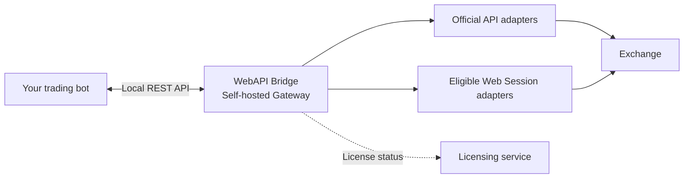

<div align="center">


# WebAPI Bridge

### One local API. Multiple exchange routes.

**A self-hosted connectivity layer for crypto trading bots, designed to unify official exchange APIs and eligible web-session integrations.**

   

**[Request early access](../../issues/new?template=early-access.yml)** · **[API reference](docs/API.md)** · **[Architecture](docs/ARCHITECTURE.md)** · **[Pricing](docs/PRICING.md)**

</div>

---

## Trading infrastructure, not another trading bot

Keep your existing trading strategy. WebAPI Bridge is designed to expose a **single local endpoint** for connecting trading bots to supported venues while handling venue-specific transport behind interchangeable adapters.

| 🔌 Connectivity | ⚡ Local-first | 🧩 Developer-friendly |
|---|---|---|
| Official API routes and selected eligible web-session integrations | Runs beside your bot on your own VPS / PC | Consistent REST resources and Python SDK patterns |

## How it fits together



Exchange credentials are intended to remain local. The licensing server would manage subscription entitlements, not receive trading orders or exchange secrets.

## Try the local API sandbox

A **working, read-only sandbox** is included in this repository. It uses simulated account data and does not connect to live exchanges or place trades.

```bash
# Terminal 1
python -m demo.server

# Terminal 2
python -m demo.example_bot
```

```python
from demo.client import WebAPIBridgeClient

gateway = WebAPIBridgeClient("http://127.0.0.1:8787")
print(gateway.health())
print(gateway.balance("paper-main"))
print(gateway.positions("paper-main"))
```

### REST API example

```bash
curl "http://127.0.0.1:8787/v1/balances?account=paper-main"
```

```json
{
  "account": "paper-main",
  "currency": "USDT",
  "total": 10000.0,
  "free": 10000.0,
  "used": 0.0,
  "simulated": true
}
```

Live order execution, connector authorization, rate limiting and production WebSocket support are part of the proposed architecture rather than implemented demo functions. See [API documentation](docs/API.md).

## Gateway control panel — design direction

The envisioned local control panel brings together **Exchange Connections**, **Local API Keys**, **Monitoring & Logs**, **Risk Controls** and **Subscription Status**. The UI is intended to use the same layout on Linux-hosted browser sessions and Windows.

## Connector coverage under evaluation

| Connector category | Example venues | Integration policy |
|---|---|---|
| Official API adapters | Bybit, Bitget, MEXC | Published exchange interfaces |
| Session-based integrations | MEXC, KCEX, AlphaX | Only where permitted and technically appropriate |
| Additional venues | Community requests | Demand- and permissions-driven |

Mentioned exchanges are **candidates**, not released integrations or official partners. No web-session route is guaranteed to retain manual-trading fees, incentives or account privileges.

## Subscription pricing direction

| | **Starter** | **Pro** | **Team** |
|---|---:|---:|---:|
| Monthly target | **$39** | **$99** | **$249** |
| Connector slots (target) | 2 | 5 | 15 |
| Gateway installations (target) | 1 | 2 | 5 |
| API & SDK | Planned | Planned | Planned |
| Monitoring | Basic | Advanced | Advanced |
| Support | Community | Priority | Team |

These are **indicative prices to validate demand**; payment collection is not enabled. [Full details](docs/PRICING.md).

## Request access

We are collecting developer feedback to prioritize production-grade integrations. **[Open an early-access request](../../issues/new?template=early-access.yml)** and tell us which exchanges, bot language and methods you need.

Please never share API secrets, cookies, session tokens or passwords in GitHub issues.

---

<sub>**Status:** this repository currently contains working simulated-data API examples and project documentation, not live-trading connectors. WebAPI Bridge is independent from the exchanges mentioned above. Use of future connectors will be subject to the venues' rules and applicable laws.</sub>
