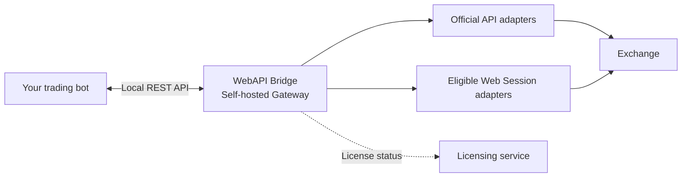

<div align="center">


# WebAPI Bridge

### One local API. Multiple exchange routes.

**A self-hosted connectivity layer for crypto trading bots, designed to unify official exchange APIs and eligible web-session integrations.**

   

### 🚀 GET WEBAPI BRIDGE ACCESS

**Request a personal introduction, discuss the exchange routes you need, and choose a subscription tier via Telegram.**

[](https://t.me/trusty_kyc_manager)

**[📩 Open Telegram — @trusty_kyc_manager](https://t.me/trusty_kyc_manager)**

[API reference](docs/API.md) · [Exchanges](docs/EXCHANGES.md) · [Architecture](docs/ARCHITECTURE.md) · [Pricing](docs/PRICING.md)

</div>

> **Access status:** Developer sandbox available. Full exchange connections are not yet released; contact us to join the access list.

---

## One gateway for your trading infrastructure

Connect your own Python, JavaScript, Go or C++ trading bot through a single **local REST API**. The WebAPI Bridge architecture separates your strategy from exchange-specific authentication, request formats and connection routes.

| 🔌 Connectivity | ⚡ Local-first | 🧩 Developer-friendly |
|---|---|---|
| Official API routes and selected eligible web-session integrations | Runs beside your bot on your own VPS / PC | Consistent REST resources and Python SDK patterns |

## How it fits together



Exchange credentials are intended to remain local. The licensing server would manage subscription entitlements, not receive trading orders or exchange secrets.

## Try the local API sandbox

A **working, read-only sandbox** is included in this repository. It uses simulated account data and does not connect to live exchanges or place trades.

```bash
# Terminal 1
python -m demo.server

# Terminal 2
python -m demo.example_bot
```

```python
from demo.client import WebAPIBridgeClient

gateway = WebAPIBridgeClient("http://127.0.0.1:8787")
print(gateway.health())
print(gateway.balance("paper-main"))
print(gateway.positions("paper-main"))
```

### REST API example

```bash
curl "http://127.0.0.1:8787/v1/balances?account=paper-main"
```

```json
{
  "account": "paper-main",
  "currency": "USDT",
  "total": 10000.0,
  "free": 10000.0,
  "used": 0.0,
  "simulated": true
}
```

Live order execution, connector authorization, rate limiting and production WebSocket support are part of the proposed architecture rather than implemented demo functions. See [API documentation](docs/API.md).

## Gateway control panel

The control panel specification covers **Exchange Connections**, **Local API Keys**, **Monitoring & Logs**, **Risk Controls**, and **Subscription Status**, with one consistent design for Linux VPS and Windows.

**Per-exchange connection selector (interface example):**

```text
New connection: MEXC
  ○ Official API   — exchange-issued API credentials
  ○ Web Session    — customer-owned session (where eligible)
  Account alias: [mexc-main]
```

The bot still calls one Gateway API. Some connection modes may be unavailable at specific venues. [See the exchange-mode matrix](docs/EXCHANGES.md).

## 24 exchanges in the integration directory

The integration directory covers 24 venues and two connection routes: **Official API** and **Web Session**. The intended interface lets users choose a mode for each account when that route is supported and permitted. Your bot continues to use one local API.

| Exchange | Official API | Web Session |
|:---|:---:|:---:|
| Binance | 🟦 API route candidate | 🔍 Under review |
| Bybit | 🟦 API route candidate | 🔍 Under review |
| OKX | 🟦 API route candidate | 🔍 Under review |
| Bitget | 🟦 API route candidate | 🔍 Under review |
| Gate.io | 🟦 API route candidate | 🔍 Under review |
| KuCoin | 🟦 API route candidate | 🔍 Under review |
| MEXC | 🟦 API route candidate | 🔍 Under review |
| BingX | 🟦 API route candidate | 🔍 Under review |
| Phemex | 🟦 API route candidate | 🔍 Under review |
| WEEX | 🟦 API route candidate | 🔍 Under review |
| Bitunix | 🟦 API route candidate | 🔍 Under review |
| Toobit | 🟦 API route candidate | 🔍 Under review |
| BloFin | 🟦 API route candidate | 🔍 Under review |
| CoinEx | 🟦 API route candidate | 🔍 Under review |
| XT.COM | 🟦 API route candidate | 🔍 Under review |
| WhiteBIT | 🟦 API route candidate | 🔍 Under review |
| CoinW | 🟦 API route candidate | 🔍 Under review |
| OrangeX | 🟦 API route candidate | 🔍 Under review |
| Tapbit | 🟨 Eligibility review | 🔍 Under review |
| Zoomex | 🟦 API route candidate | 🔍 Under review |
| Pionex | 🟨 Access conditions review | 🔍 Under review |
| BTCC | 🟨 Current API status review | 🔍 Under review |
| KCEX | — No publicly offered trading API | 🔍 Under review |
| AlphaX | 🟨 Availability review | 🔍 Under review |

**Legend:** 🟦 proposed official integration · 🟨 availability/eligibility to verify · 🔍 web-session feasibility and permission review · — no route represented.

**Important:** This is an **integration roadmap**, not a list of live connectors. A mode appears in the planned selector only when the relevant exchange actually supports it; unavailable options are disabled. Web Session does **not** imply permission to automate the website or eligibility for manual-trading fees or promotions.

**[Explore connection-mode design and all exchanges →](docs/EXCHANGES.md)**

> 💬 **Need access for a specific exchange? [Message @trusty_kyc_manager on Telegram](https://t.me/trusty_kyc_manager)** and tell us which route you need.

## Subscription packages

| | **Starter** | **Pro** | **Team** |
|---|---:|---:|---:|
| Price / month* | **$19** | **$49** | **$149** |
| Connector slots | 2 | 5 | 15 |
| Gateway installations | 1 | 2 | 5 |
| Local REST API & SDK | Included in package concept | Included in package concept | Included in package concept |
| Monitoring | Basic | Advanced | Advanced |
| Support | Community | Priority | Team |

*Indicative package prices for customer research, not an active checkout. [Package details](docs/PRICING.md).

> **📩 Interested in Starter, Pro or Team? [Message @trusty_kyc_manager on Telegram](https://t.me/trusty_kyc_manager) to request access.**

## 📩 Get access — Telegram

### **[👉 MESSAGE @trusty_kyc_manager ON TELEGRAM](https://t.me/trusty_kyc_manager)**

**This is the primary contact for WebAPI Bridge access requests.** Let us know which exchanges you need, whether you prefer Official API or Web Session, and what language your bot uses.

Contact the maintainer to register interest and confirm availability.

Please never send passwords, exchange API keys, cookies or web-session tokens in Telegram or GitHub issues.

---

<sub>**Availability:** A working simulated-data API sandbox is available in this repository; production trading connectors are not released here. All exchange names refer to integration candidates, not partnerships. Future access depends on exchange rules and applicable law.</sub>
