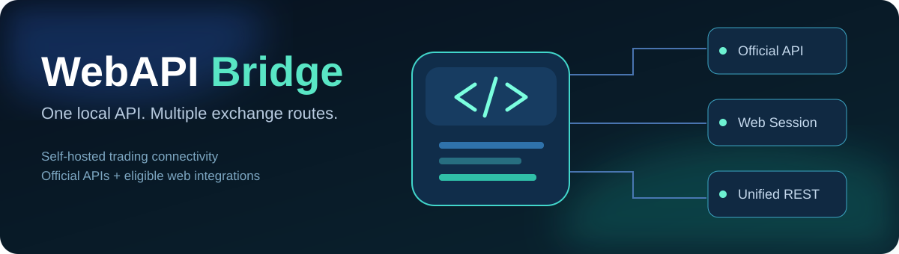
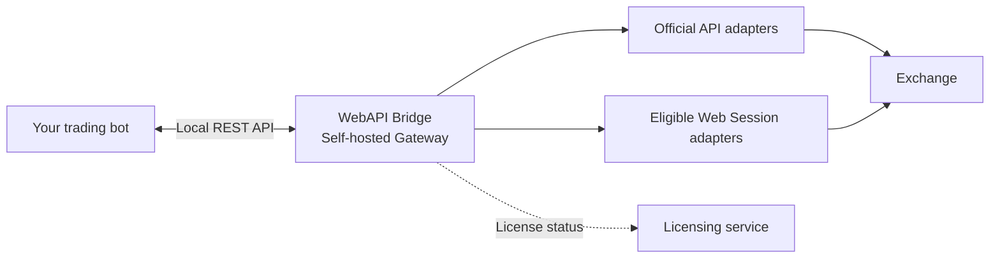

<div align="center">



# WebAPI Bridge

### One local API. Multiple exchange routes.

**A self-hosted connectivity layer for crypto trading bots, designed to unify official exchange APIs and eligible web-session integrations.**

   

### 🚀 WANT ACCESS TO WEBAPI BRIDGE?

**Contact us directly on Telegram to discuss early access, supported exchanges and subscription options.**

[](https://t.me/trusty_kyc_manager)

**[📩 Open Telegram — @trusty_kyc_manager](https://t.me/trusty_kyc_manager)**

[API reference](docs/API.md) · [Exchanges](docs/EXCHANGES.md) · [Architecture](docs/ARCHITECTURE.md) · [Pricing](docs/PRICING.md)

</div>

---

## Trading infrastructure, not another trading bot

Keep your existing trading strategy. WebAPI Bridge is designed to expose a **single local endpoint** for connecting trading bots to supported venues while handling venue-specific transport behind interchangeable adapters.

| 🔌 Connectivity | ⚡ Local-first | 🧩 Developer-friendly |
|---|---|---|
| Official API routes and selected eligible web-session integrations | Runs beside your bot on your own VPS / PC | Consistent REST resources and Python SDK patterns |

## How it fits together



Exchange credentials are intended to remain local. The licensing server would manage subscription entitlements, not receive trading orders or exchange secrets.

## Try the local API sandbox

A **working, read-only sandbox** is included in this repository. It uses simulated account data and does not connect to live exchanges or place trades.

```bash
# Terminal 1
python -m demo.server

# Terminal 2
python -m demo.example_bot
```

```python
from demo.client import WebAPIBridgeClient

gateway = WebAPIBridgeClient("http://127.0.0.1:8787")
print(gateway.health())
print(gateway.balance("paper-main"))
print(gateway.positions("paper-main"))
```

### REST API example

```bash
curl "http://127.0.0.1:8787/v1/balances?account=paper-main"
```

```json
{
  "account": "paper-main",
  "currency": "USDT",
  "total": 10000.0,
  "free": 10000.0,
  "used": 0.0,
  "simulated": true
}
```

Live order execution, connector authorization, rate limiting and production WebSocket support are part of the proposed architecture rather than implemented demo functions. See [API documentation](docs/API.md).

## Gateway control panel — design direction

The envisioned local control panel brings together **Exchange Connections**, **Local API Keys**, **Monitoring & Logs**, **Risk Controls** and **Subscription Status**. The UI is intended to use the same layout on Linux-hosted browser sessions and Windows.

## 24 exchange targets — choose your connection method

The control-panel concept lets you select **Official API** or **Web Session** for each exchange connection, where that mode is supported and authorized. One unified API remains the same regardless of the selected connection mode.

| Exchange | Official API | Web Session |
|:---|:---:|:---:|
| Binance | 🟦 API route candidate | 🔍 Under review |
| Bybit | 🟦 API route candidate | 🔍 Under review |
| OKX | 🟦 API route candidate | 🔍 Under review |
| Bitget | 🟦 API route candidate | 🔍 Under review |
| Gate.io | 🟦 API route candidate | 🔍 Under review |
| KuCoin | 🟦 API route candidate | 🔍 Under review |
| MEXC | 🟦 API route candidate | 🔍 Under review |
| BingX | 🟦 API route candidate | 🔍 Under review |
| Phemex | 🟦 API route candidate | 🔍 Under review |
| WEEX | 🟦 API route candidate | 🔍 Under review |
| Bitunix | 🟦 API route candidate | 🔍 Under review |
| Toobit | 🟦 API route candidate | 🔍 Under review |
| BloFin | 🟦 API route candidate | 🔍 Under review |
| CoinEx | 🟦 API route candidate | 🔍 Under review |
| XT.COM | 🟦 API route candidate | 🔍 Under review |
| WhiteBIT | 🟦 API route candidate | 🔍 Under review |
| CoinW | 🟦 API route candidate | 🔍 Under review |
| OrangeX | 🟦 API route candidate | 🔍 Under review |
| Tapbit | 🟨 Eligibility review | 🔍 Under review |
| Zoomex | 🟦 API route candidate | 🔍 Under review |
| Pionex | 🟨 Access conditions review | 🔍 Under review |
| BTCC | 🟨 Current API status review | 🔍 Under review |
| KCEX | — No publicly offered trading API | 🔍 Under review |
| AlphaX | 🟨 Availability review | 🔍 Under review |

**Legend:** 🟦 proposed official integration · 🟨 availability/eligibility to verify · 🔍 web-session feasibility and permission review · — no route represented.

**Important:** This is an **integration roadmap**, not a list of live connectors. A mode appears in the planned selector only when the relevant exchange actually supports it; unavailable options are disabled. Web Session does **not** imply permission to automate the website or eligibility for manual-trading fees or promotions.

**[Explore connection-mode design and all exchanges →](docs/EXCHANGES.md)**

> 💬 **Need access for a specific exchange? [Message @trusty_kyc_manager on Telegram](https://t.me/trusty_kyc_manager)** and tell us which route you need.

## Subscription pricing direction

| | **Starter** | **Pro** | **Team** |
|---|---:|---:|---:|
| Monthly target | **$19** | **$49** | **$149** |
| Connector slots (target) | 2 | 5 | 15 |
| Gateway installations (target) | 1 | 2 | 5 |
| API & SDK | Planned | Planned | Planned |
| Monitoring | Basic | Advanced | Advanced |
| Support | Community | Priority | Team |

These are **indicative prices to validate demand**; payment collection is not enabled. [Full details](docs/PRICING.md).

> **📩 Interested in Starter, Pro or Team? [Message @trusty_kyc_manager on Telegram](https://t.me/trusty_kyc_manager) to request access.**

## 📩 Get access — Telegram

### **[👉 MESSAGE @trusty_kyc_manager ON TELEGRAM](https://t.me/trusty_kyc_manager)**

**This is the primary contact for WebAPI Bridge access requests.** Let us know which exchanges you need, whether you prefer Official API or Web Session, and what language your bot uses.

Early-access requests are being collected; production connector access is not yet generally available.

Please never send passwords, exchange API keys, cookies or web-session tokens in Telegram or GitHub issues.

---

<sub>**Status:** this repository currently contains working simulated-data API examples and project documentation, not live-trading connectors. WebAPI Bridge is independent from the exchanges mentioned above. Use of future connectors will be subject to the venues' rules and applicable laws.</sub>
