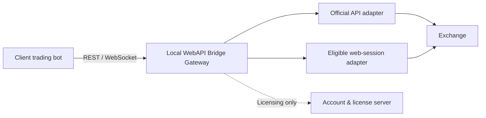

# Architecture

### Design principles

- The Gateway runs on the customer's own Linux VPS or Windows device.
- API requests stay local between the user's bot and the Gateway.
- Exchange secrets are stored locally, not sent to the licensing platform.
- Live order routes must be explicit; no automatic route switching after an ambiguous timeout.
- Withdrawals are outside scope.
- Session-based adapters may be offered only where permitted by the venue and applicable law.

**Current repository contents:** a working paper-data sandbox, demonstration client and product specification. No production trading connectors are supplied here.
