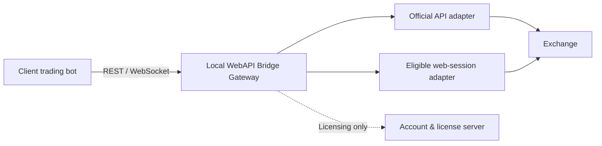

# Architecture

### Selectable route per account

A customer's account configuration would bind an alias to a venue and a **specific** integration type (`official_api` or `web_session`). Supported, authorized modes can be selected in the local control panel. Both routes share a normalized local API contract, so the bot does not need to implement exchange-specific login flows.

If an exchange does not offer a trading API, the official route must be unavailable. Likewise, Web Session must not be enabled until technical, contractual and legal checks permit it. See [exchange candidates](EXCHANGES.md).

### Design principles

- The Gateway runs on the customer's own Linux VPS or Windows device.
- API requests stay local between the user's bot and the Gateway.
- Exchange secrets are stored locally, not sent to the licensing platform.
- Live order routes must be explicit; no automatic route switching after an ambiguous timeout.
- Withdrawals are outside scope.
- Session-based adapters may be offered only where permitted by the venue and applicable law.

**Current repository contents:** a working paper-data sandbox, demonstration client and product specification. No production trading connectors are supplied here.
